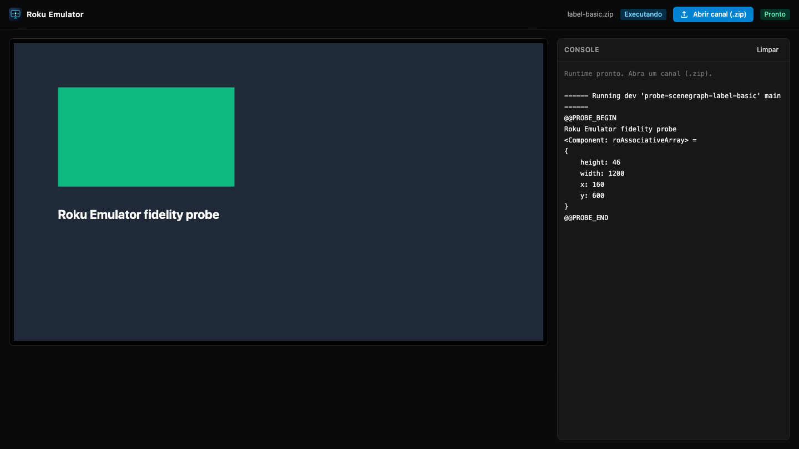
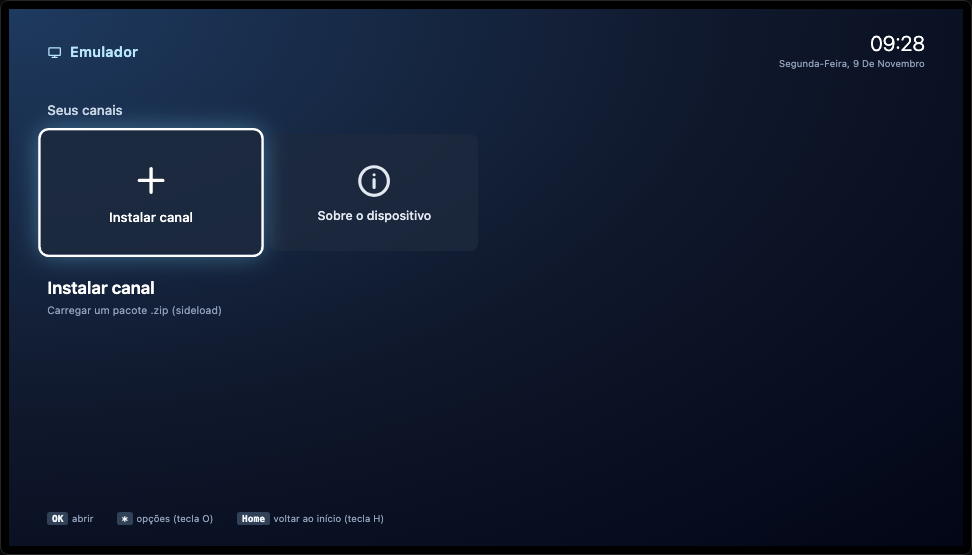
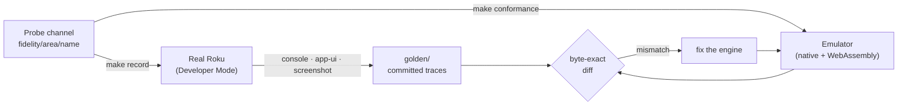

<div align="center">


# Roku Emulator

### Run Roku channels in your browser, verified against a real device.

**BrightScript and SceneGraph, compiled to WebAssembly, diffed byte by byte against Roku hardware.**

[](https://github.com/FernandoHaeser/roku-emulator/actions/workflows/ci.yml)
[](#how-fidelity-works)
[](crates/brs-core)
[](crates/brs-wasm)
[](apps/web)
[](CHANGELOG.md)
[](LICENSE)

[Quick start](#quick-start) · [How fidelity works](#how-fidelity-works) · [Features](#features) · [Status](#status) · [Commands](#commands) · [FAQ](#faq) · [Documentation](#documentation) · [License](#license)

<code>make setup && make dev</code>

</div>

> [!NOTE]
> Independent open project. Not affiliated with, endorsed by or sponsored by
> Roku, Inc. "Roku" is a trademark of Roku, Inc., used here only to describe
> compatibility. The emulator contains no Roku firmware, fonts or system assets.

<div align="center">

<br />



<br /><br />

</div>

---

Testing a Roku channel usually means a physical device, a sideload per change
and a telnet console. **Roku Emulator** runs the same sideload `.zip` in any
browser: it boots into a home screen, launches your developer channel, renders
its SceneGraph scene, takes the remote from your keyboard and streams the
console, all locally.

The goal is **device-level fidelity**, not "looks about right". A real Roku in
Developer Mode is the **oracle**: every behavior is captured on the device and
the emulator must reproduce it exactly, down to `PRINT` column widths and the
Micro Debugger crash dump.

## Quick start

macOS or Linux with `make`, `curl` and nvm (or fnm):

```bash
git clone git@github.com:FernandoHaeser/roku-emulator.git
cd roku-emulator
make setup   # Node 22, pnpm, Rust + wasm target, dependencies, .env
make dev     # http://127.0.0.1:5173
```

Open the page, press **OK** on _Instalar canal_ (or click _Abrir canal (.zip)_)
and pick your channel's sideload zip. It becomes the developer channel and
launches right away.

Prefer the terminal? Run it natively, console to stdout:

```bash
make run CHANNEL=path/to/channel   # directory or .zip
```

<table>
<tr>
<td width="50%" valign="top">

**Remote control** (layout independent)

| Key             | Remote                   |
| --------------- | ------------------------ |
| Arrows          | Up / Down / Left / Right |
| Enter           | OK                       |
| Backspace / Esc | Back                     |
| H / Home        | Home (leave channel)     |
| O               | Options (`*`)            |
| Space / , / .   | Play / Rev / Fwd         |
| R               | Instant replay           |

</td>
<td width="50%" valign="top">

**Home screen**



OK opens the focused tile, Options opens the channel menu (open / remove).
The developer channel and its registry survive page reloads, like a reboot.

</td>
</tr>
</table>

## How fidelity works



1. **Probe:** a minimal channel exercises one area (operators, `roDateTime`,
   observer order, focus...) and prints between `@@PROBE_BEGIN` / `@@PROBE_END`.
2. **Record:** the oracle sideloads it on the device, sends remote keys and
   captures the console, `query/app-ui` and a screenshot into `golden/`.
3. **Match:** `make conformance` runs every probe in the engine and diffs it
   with the golden. CI runs it on every pull request, without a device.

When the official documentation and a golden disagree, **the golden wins**.
Every confirmed behavior is written down in
[docs/brightscript-semantics.md](docs/brightscript-semantics.md) next to the
probe that proves it. Known gaps stay as failing probes, never masked.

## Features

| Area                    | What it does                                                                                                                                                                                                        |
| ----------------------- | ------------------------------------------------------------------------------------------------------------------------------------------------------------------------------------------------------------------- |
| **BrightScript engine** | Lexer, parser, compiler and a resumable bytecode VM in Rust. Device-exact `PRINT`, number formatting, numeric promotion, `TRY/CATCH`, and the Micro Debugger crash dump (source window, digest, backtrace, locals). |
| **Threads**             | Main, render and one thread per `Task`, round-robin scheduled, with rendezvous on field sets, like the device.                                                                                                      |
| **SceneGraph**          | XML components with `extends` chains, typed fields, `observeField`, `alwaysNotify`, focus chain and `onKeyEvent`, `Task`, `Timer`, `roSGScreen`, `m.global`, `boundingRect`.                                        |
| **Runtime objects**     | `roArray`, `roAssociativeArray`, `roList`, `roByteArray`, `roMessagePort` + `wait`, `roDateTime`, `roTimespan`, `roAppInfo`, `roDeviceInfo`, `roRegistry`, `roXMLElement`, boxed types, `ParseJson` / `FormatJson`. |
| **Browser host**        | One Rust core compiled to WebAssembly, run in a Web Worker in time slices; Canvas2D renderer of the SceneGraph display list; persistent registry.                                                                   |
| **Native host**         | The same core as a CLI (`brs run`, `brs conformance`); a desktop app comes later from the same crate.                                                                                                               |
| **Oracle**              | Node client for the real device: Digest-auth sideload, telnet console, ECP keys and queries, screenshots, text / XML / pixel diffs.                                                                                 |

## Status

Beta. Phases follow the [roadmap](#roadmap); details in the [CHANGELOG](CHANGELOG.md).

| Area                       | State                                                                                              |
| -------------------------- | -------------------------------------------------------------------------------------------------- |
| Fidelity oracle            | Working against a real device (H302X, Roku OS 16.0.4), including remote key steps                  |
| BrightScript language (F1) | Byte-exact except `language/collections` (25 / 26 probes overall)                                  |
| Runtime objects (F2)       | Done: network via local proxy, files, regex, crypto (device-verified probe `runtime/extended`)     |
| SceneGraph core (F3)       | Done; field `alias`, `ComponentLibrary` pending                                                    |
| Renderer (F4)              | Screenshot diffs, measured text, package fonts, Poster/9-patch, remote loads, rotation, animations |
| Widgets (F5)               | In progress: lists, grid bindings, buttons, modal dialogs and keyboard                             |
| Video (F6)                 | In progress: device-recorded lifecycle (MP4, HLS, DASH, HTTP errors) and Widevine DRM errors       |
| VS Code debugging (F7)     | Done: deploy, console, telnet and binary (8081) debugger, SceneGraph callback suspension           |

**Known gaps** (tracked by failing conformance):

- `FOR EACH` over an associative array follows the device's internal hash
  order; the emulator uses insertion order (`language/collections`).
- System text widths remain approximate: the system-font reference in
  `scenegraph/label-package-font` differs by 3 design pixels. Package-font
  measurements in that probe match; glyph screenshots retain visual budgets.
- Float-literal promotion to Double uses a provisional digit threshold.
- Glyph shapes come from a bundled substitute font (Inter, OFL); widths, line
  breaks and line heights follow device metrics (±1 px for ~3/4 of strings).
- Widget support (F5) is in progress. Native-theme artwork, animated widget
  scrolling, sections and specialized widgets are not fully reproduced.
  The Roku system font is not redistributable, so a bundled substitute is used.
- Video (F6) is in progress. Playback events, defaults, HTTP and DRM errors
  match `video/lifecycle` and `video/drm`; trick play, captions and
  audio-track selection are not implemented yet. CLI and VS Code use a
  simulated player (timing only, no frames). Widevine content plays only in
  browsers with a Widevine CDM (Chrome, Edge, Firefox); elsewhere, including
  the Playwright Chromium, the plane stays black while events follow the
  simulated clock. License servers are checked with a Widevine service
  certificate request, not a real license exchange.

## Roadmap

| Phase                   | Scope                                                                                           | Status      |
| ----------------------- | ----------------------------------------------------------------------------------------------- | ----------- |
| F0 · Foundation         | Monorepo, oracle, reference device profile                                                      | Done        |
| F1 · Language           | BrightScript semantics byte-exact vs the device                                                 | Done        |
| F2 · Runtime objects    | `ro*` non-visual components                                                                     | Done        |
| F3 · SceneGraph core    | Components, fields, observers, threads, focus                                                   | Done        |
| F4 · Renderer           | Pixel diffs vs device screenshots, fonts, animations                                            | In progress |
| F5 · Widgets            | Device-probed list/grid events and bindings, buttons, modal dialogs and keyboard                | In progress |
| F6 · Video              | `Video` node over Shaka Player, Widevine via EME                                                | In progress |
| F7 · Tooling            | Dev installer, ECP, console, telnet and binary debug protocol                                   | Done        |
| F8 · Shell              | Clickable remote, node inspector, network and registry panels, hot reload                       | Partial     |
| F9 · Closed libraries   | Configurable mocks for ads, analytics and channel store                                         | Planned     |
| F10 · VS Code extension | Own extension: embedded emulator, project setup, debugger; CI on 3 OSes, release workflow ready | Unpublished |

Detailed delivery order and extension acceptance criteria: [delivery roadmap](docs/roadmap.md).

## Architecture

```
apps/web (React shell) ── postMessage ──▶ Web Worker
  home screen · console                   ├─ brs-wasm (Rust core → WebAssembly)
  sideload · remote keys                  │    compiler · VM · threads · ro* · SceneGraph
                                          └─ CanvasRenderer (display list → OffscreenCanvas)

crates/brs-cli    same Rust core, native: brs run · brs conformance
packages/oracle   Node client ⇄ real Roku: sideload · telnet console · ECP · screenshots
```

One core, two targets: the web shell and the oracle stay in TypeScript, and the
oracle's goldens are the shared conformance suite for both. Details in
[docs/architecture.md](docs/architecture.md).

| Path                | Contents                                                                      |
| ------------------- | ----------------------------------------------------------------------------- |
| `crates/brs-core`   | BrightScript engine: lexer, parser, compiler, VM, runtime objects, SceneGraph |
| `crates/brs-cli`    | Native `brs` binary: run a channel, run conformance                           |
| `crates/brs-wasm`   | C-ABI WebAssembly exports used by the browser worker                          |
| `apps/web`          | React shell, worker runtime host, Canvas2D renderer, Playwright e2e           |
| `packages/protocol` | Typed messages between the shell and the worker; remote keys                  |
| `packages/oracle`   | Device client: sideload, console capture, ECP, screenshots, diff              |
| `fidelity/`         | Probe channels and their device-recorded `golden/` traces                     |
| `profiles/`         | Reference device profile (identifiers redacted)                               |
| `scripts/`          | Setup, environment activation, cargo wrapper, wasm build                      |

## Commands

| Command                               | What it does                                                    |
| ------------------------------------- | --------------------------------------------------------------- |
| `make help`                           | List every target                                               |
| `make setup`                          | Install Node 22, pnpm, Rust + wasm target, dependencies, `.env` |
| `make dev`                            | Build wasm + web shell at http://127.0.0.1:5173                 |
| `make run CHANNEL=<dir\|zip>`         | Run a channel natively, console to stdout                       |
| `make test`                           | Rust + TypeScript unit tests                                    |
| `make conformance`                    | Run probes in the engine and diff with goldens                  |
| `make e2e`                            | Browser fidelity tests (Playwright)                             |
| `make check`                          | Every CI gate except e2e                                        |
| `make format`                         | Prettier + rustfmt                                              |
| `make build` / `make wasm`            | Production build / wasm only                                    |
| `make record PROBE=fidelity/language` | Run probes on the device and write `golden/`                    |
| `make oracle ARGS="device-info"`      | Oracle CLI (`profile`, `list`, `screenshot`, `diff`)            |
| `make doctor`                         | Print the resolved tool versions                                |
| `make clean`                          | Remove build outputs                                            |

Every target runs through `scripts/run.sh`, which activates the right Node,
pnpm and Rust; no `nvm use` needed. To use the raw tools in your shell,
`source scripts/env.sh`.

<details>
<summary><strong>Setup details</strong></summary>

`make setup` (or `./scripts/setup.sh`) checks each prerequisite and installs
what is missing. It asks first; `./scripts/setup.sh --yes` skips the questions
and `make setup-e2e` also installs the Playwright browser.

1. Node 22 via nvm or fnm (from `.nvmrc`).
2. pnpm via corepack (version from `package.json`).
3. rustup, the pinned toolchain and the `wasm32-unknown-unknown` target.
   Homebrew's `rust` formula is not enough (no wasm target); the scripts prefer
   rustup's toolchain even when it is on PATH.
4. `pnpm install --frozen-lockfile`, Rust crates and the wasm build.
5. `.env` from `.env.example` when missing. Fill `ROKU_HOST` and
   `ROKU_DEV_PASSWORD` to use the oracle. **Never commit `.env`.**

To record goldens you need a Roku with Developer Mode enabled and
_Settings > System > Advanced system settings > Control by mobile apps_ set to
**Permissive**.

</details>

<details>
<summary><strong>Writing a probe</strong></summary>

A probe is a minimal channel under `fidelity/<area>/<name>/` that prints its
observable output between `@@PROBE_BEGIN` and `@@PROBE_END`. An optional
`probe.json` adds remote key steps and app-ui / screenshot capture:

```json
{
  "kind": "conformance",
  "steps": [{ "key": "Down", "waitMs": 300 }],
  "startDelayMs": 1000,
  "settleMs": 500,
  "capture": { "appUi": true, "screenshot": true }
}
```

Key steps start `startDelayMs` after `@@PROBE_BEGIN` (default 1000), both on
the device and in the emulator. `kind: "bench"` probes produce timing metrics
and are never diffed. Goldens in `golden/` are committed; raw device logs go to
the git-ignored `.oracle/`. Full workflow in
[docs/fidelity-workflow.md](docs/fidelity-workflow.md).

</details>

<details>
<summary><strong>Troubleshooting</strong></summary>

- **`EHOSTUNREACH` from Node while `curl` works:** macOS Local Network privacy
  is blocking that Node binary. Allow your terminal in _System Settings >
  Privacy & Security > Local Network_ (toggle off/on if already enabled).
- **`zsh: correct 'pnpm' to 'npm'`:** pnpm is not active in your shell. Use the
  `make` targets, or `source scripts/env.sh`.
- **Connect timeouts right after a probe:** the device stalls while the Home
  screen reloads. The oracle retries connection-phase failures automatically.
- **`CreateObject` returns `invalid`:** the class is not implemented yet; the
  console shows the device's `unknown classname "X"` diagnostic.

</details>

## FAQ

<details>
<summary><strong>Do I need a Roku to use it?</strong></summary>

No. Running channels, conformance and e2e work without a device: the goldens
are committed. A device is only needed to record new goldens.

</details>

<details>
<summary><strong>Is the home screen the real Roku UI?</strong></summary>

No. The Roku OS interface is proprietary, so the home screen is an original
launcher that follows the device's interaction model (tile grid, OK, Back,
Options, Home), not its look.

</details>

<details>
<summary><strong>Was Roku firmware reverse engineered?</strong></summary>

No. Fidelity comes from black-box observation only: probes run on a device the
author owns and the emulator is written from scratch to match their output.
No firmware, fonts or system assets are extracted or shipped.

</details>

<details>
<summary><strong>Can I debug from VS Code like on a device?</strong></summary>

Deploy, console and basic telnet debugging are implemented. A browser test uses
the real RokuCommunity adapter to deploy, inspect a STOP, step and continue.
See [VS Code setup and debugger limits](docs/vscode-deploy.md). Full expression
evaluation, synchronous SceneGraph callback breaks and binary debugging remain
pending.

</details>

## Documentation

| Document                                                         | Contents                                                                                      |
| ---------------------------------------------------------------- | --------------------------------------------------------------------------------------------- |
| [docs/architecture.md](docs/architecture.md)                     | Engine pipeline, VM and threads, SceneGraph, display list, wasm ABI, worker loop, home screen |
| [docs/brightscript-semantics.md](docs/brightscript-semantics.md) | Behaviors confirmed on the device, each with the probe that proves it                         |
| [docs/fidelity-workflow.md](docs/fidelity-workflow.md)           | Add a probe, record it on the device, make the emulator match                                 |
| [docs/marketplace-publishing.md](docs/marketplace-publishing.md) | Publish the VS Code extension: Entra ID (OIDC) setup, releases, troubleshooting               |
| [docs/git-workflow.md](docs/git-workflow.md)                     | Gitflow: `develop` (default), `release` (pre-prod), `master` (prod), PRs and releases         |
| [CHANGELOG.md](CHANGELOG.md)                                     | Changes per phase                                                                             |

## Contributing

Work happens on `feature/*` branches with pull requests into `develop`; CI runs
format, lint, type checks, unit tests, conformance and e2e. See
[docs/git-workflow.md](docs/git-workflow.md).

## License

Licensed under the [Apache License, Version 2.0](LICENSE). See [NOTICE](NOTICE).

Apache-2.0 includes an explicit **patent grant**: every contributor licenses
the patents their contribution needs, and anyone who sues claiming the project
infringes a patent loses that license. Contributions are accepted under the
same license (section 5).
