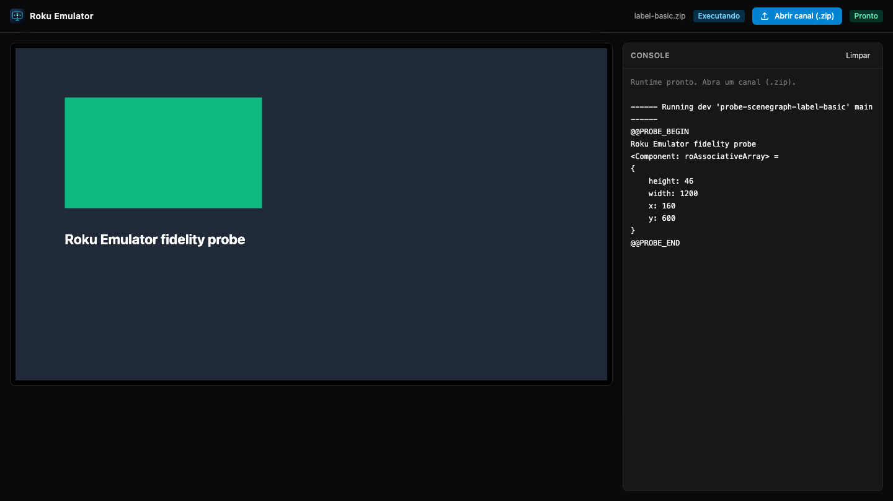

# Roku Emulator for VS Code

Run and debug Roku channels locally, without a device. The extension embeds an
open source emulator (Rust engine compiled to WebAssembly) in a VS Code panel and
debugs it over the same binary protocol a real device uses.

> **Preview.** Independent open project. Not affiliated with, endorsed by or
> sponsored by Roku, Inc. "Roku" is a trademark of Roku, Inc., used here only to
> describe compatibility.



## Features

- **Embedded emulator**: the screen, a clickable remote and the console run
  inside VS Code. The runtime starts in a Node Worker owned by the extension and
  stops with it.
- **One-command setup**: _Roku Emulator: Configurar projeto_ adds a launch
  configuration to `.vscode/launch.json` and keeps your other entries and
  comments.
- **Debugger**: line breakpoints, hit counts, `STOP`, pause, continue,
  step into/over/out, threads, stack frames, variable expansion, watches,
  hovers and setting variables, including inside SceneGraph callbacks
  (`init`, observers, `onKeyEvent`, `callFunc`).
- **Network through a local proxy**: `roUrlTransfer` sync and async, headers,
  cookies, Digest authentication and cancellation work without CORS limits.
- **Device-verified behavior**: engine output is compared byte for byte with
  traces recorded on a real device.

## Quick start

1. Open a channel folder (one that has a `manifest` file).
2. Run **Roku Emulator: Configurar projeto** from the Command Palette.
3. Press <kbd>F5</kbd> and pick **Roku Emulator**. The channel is zipped,
   deployed and launched in the embedded panel.

```json
{
  "name": "Roku Emulator",
  "type": "roku-emulator",
  "request": "launch",
  "rootDir": "${workspaceFolder}"
}
```

The [BrightScript Language extension](https://marketplace.visualstudio.com/items?itemName=RokuCommunity.brightscript)
is installed alongside (extension pack) for language features. Physical-device
launch configurations keep working next to this one.

## Commands

| Command                           | Action                                          |
| --------------------------------- | ----------------------------------------------- |
| Roku Emulator: Abrir emulador     | Show the embedded emulator panel                |
| Roku Emulator: Iniciar / Parar    | Start or stop the runtime                       |
| Roku Emulator: Reiniciar          | Restart the runtime                             |
| Roku Emulator: Configurar projeto | Add the launch configuration                    |
| Roku Emulator: Selecionar runtime | Switch between bundled and external runtime     |
| Roku Emulator: Abrir no navegador | Open the running emulator in the system browser |

## Settings

| Setting                    | Default                           | Description                                 |
| -------------------------- | --------------------------------- | ------------------------------------------- |
| `rokuEmulator.runtime`     | `bundled`                         | Bundled runtime or an existing local server |
| `rokuEmulator.externalUrl` | `http://127.0.0.1:5173/?device=1` | URL used in external runtime mode           |
| `rokuEmulator.ecpPort`     | `8060`                            | ECP and developer installer port            |
| `rokuEmulator.consolePort` | `8085`                            | Telnet console port                         |
| `rokuEmulator.debugPort`   | `8081`                            | Binary debug protocol port                  |

All ports bind to loopback (`127.0.0.1`) only.

## Compatibility

| Item              | Supported                                                       |
| ----------------- | --------------------------------------------------------------- |
| VS Code           | 1.95 or newer (desktop; not vscode.dev or untrusted workspaces) |
| Operating systems | macOS, Windows and Linux (x64), tested in CI                    |
| Remote/WSL/SSH    | Not validated yet                                               |
| Channel types     | BrightScript and SceneGraph (XML components)                    |
| Reference device  | Roku OS 16.0.4, 720p UI profile                                 |

## Known limits

- Rendering, fonts and widgets (RowList, MarkupGrid, keyboards, dialogs) are
  provisional; video playback is not implemented yet.
- Breakpoint conditions written as expressions are not supported (hit counts
  are). Stepping across several statements on one source line is not supported.
- `FOR EACH` over an associative array uses insertion order, not the device's
  hash order.
- Closed-source device libraries (ads, analytics, channel store) are not
  emulated yet.

Full status and roadmap: [github.com/FernandoHaeser/roku-emulator](https://github.com/FernandoHaeser/roku-emulator).

## License

Apache-2.0. Bundled third-party code keeps its own licenses (see `NOTICE`).
